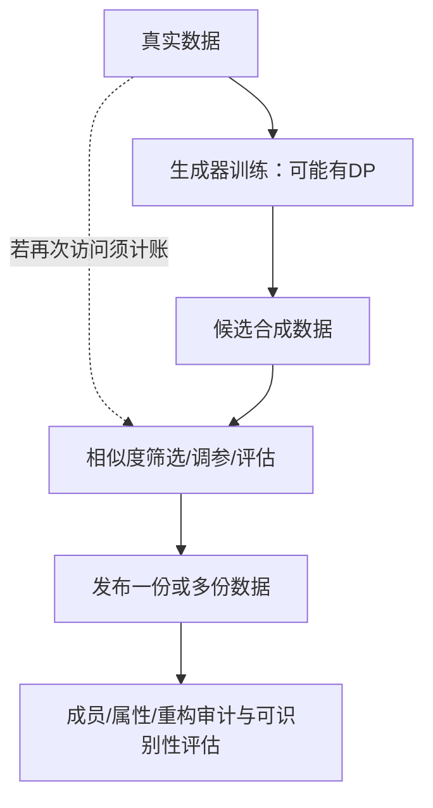

import PrivacyMeta from '@site/src/components/PrivacyMeta';

<PrivacyMeta era="卷六 · 治理与合规" technique="PII 检测与脱敏" audience={['隐私工程师', '合规工程师', 'ML 工程师']} severity="中" maturity="研究" evidence="研究支持" />

> 一句话摘要：合成数据不自动匿名，相似度测试可能漏掉成员、属性和重构泄露。DP 可给指定单位的贡献保证，但须覆盖训练、筛选、评估和发布的完整机制；**有 DP 不自动等于法律匿名**，没有 DP 也不能据此否定所有其他形式定义。

## 机制：我这边发生了什么

生成器从真实数据拟合分布后采样，某记录的纳入可能改变模型或合成输出。攻击者可利用候选记录、领域先验、已发布数据或生成器访问测试这种差异。有限静态样本集与可无限查询生成器的访问能力不同，不能统一称同一种预算。红线：我的自述「这条是虚构的」不能认证训练来源或匿名性。



## 威胁面

相似度小不代表个体影响小，平均指标也可能遗漏脆弱群体。若已 DP 训练的模型之后用原数据做未计账筛选，这不是只访问 DP 输出的后处理，不能继承原保证。人口相关性本就可预测的属性也不会被个体 DP 全部消除。

## 防护原理

若目标是 DP，固定邻接关系、记录/用户单位、δ及全部私有访问的组合。固定 DP 发布在不再访问真实数据时可后处理复用；重新训练、筛选与额外发布另计。若不声称 DP，仍需明确其他保护目标、访问限制与经验依据，不能只写「合成所以匿名」。

## 落地实现（配方）

```text
1. 定义发布物与对手：有限数据、生成器 API 还是权重；固定查询/多份发布预算。
2. 画完整私有访问图：训练、调参、真实数据指标筛选、私有评估和发布都纳入。
3. DP 路径独立复算单位与组合；指标筛选不要绕回未计账原数据。
4. 在受控/授权成员、非成员及脆弱群体上测 MIA/属性/重构，报告区间与任务效用。
5. 单独作法域可识别性评估；厂商默认和 epsilon 推荐按具体版本核，不照搬。
```

**最小可测试断言**：声称 DP 时整链私有访问均有预算与可信边界，独立会计一致；经验攻击指标/效用按目标报告。攻击失败不证明匿名，攻击高于随机也不自动与宽松ε矛盾。

## 真实案例 / 研究进展

Stadler 等（USENIX2022）实测所研究合成器的隐私效用取舍并不优于传统匿名化，不能推广成任何未来生成器的不可能定理。ReconSyn（IEEE S&P2025 v5）给出通过相似度测试仍泄露的反例，尤其指出只给模型加 DP、原数据驱动的筛选不计账会破坏端到端保证。ICO 匿名化指引要求按可识别性评估并持续复评，非「合成」标签自动豁免。

## 残余风险与权衡

预算与单位决定保护，生成质量不能替代隐私证据。去除离群记录本身可能是数据依赖预处理，若声称从原始数据到发布物的 DP，也须纳入分析。本文不背书未核的供应商默认、预算推荐或 PATE-GAN 复现结论。

## 与相邻技术的区别

[PII 脱敏](../03-conversational-llms/pii-regurgitation.mdx)与合成是不同处理，均不自动匿名；[DP 微调](../03-conversational-llms/dp-fine-tuning.mdx)的会计纪律在生成器同样适用。[去重](../02-memorization-extraction/training-data-deduplication.mdx)降低重复暴露，但也要考虑数据依赖预处理。

## 版本说明

:::note 适用版本
2026-10-29 核对 ReconSyn v5、USENIX2022、ICO 与 NIST 最终指南，保留反例和端到端 DP 条件，去除无当前出处的供应商参数及「只有 DP 才有任何上界」全称。未运行生成器实验。2027-01-29 前，或生成/筛选、发布预算与匿名化指引变化时复核。
:::

## 延伸阅读与出处

- [ReconSyn（IEEE S&P2025）](https://arxiv.org/abs/2312.05114)
- [Synthetic Data – Anonymisation Groundhog Day](https://www.usenix.org/conference/usenixsecurity22/presentation/stadler)
- [ICO 匿名化指引](https://ico.org.uk/for-organisations/uk-gdpr-guidance-and-resources/data-sharing/anonymisation/introduction-to-anonymisation/)
- [NIST SP800-226 最终版](https://csrc.nist.gov/pubs/sp/800/226/final)
